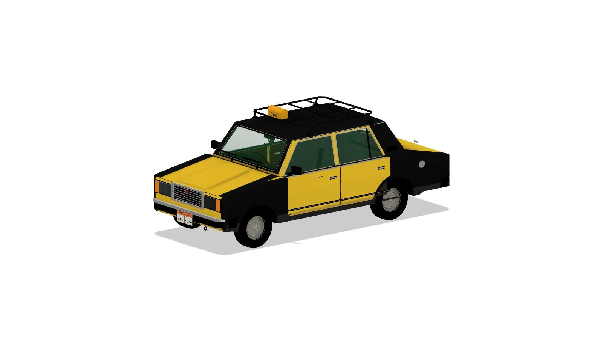
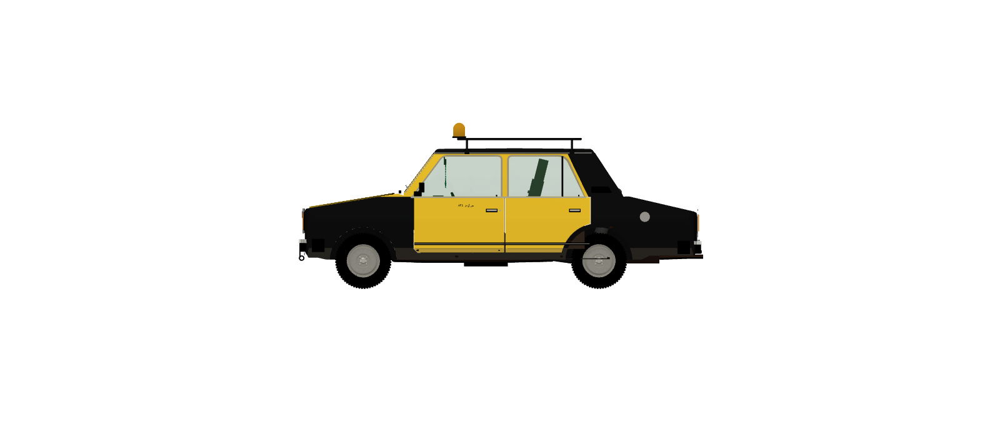
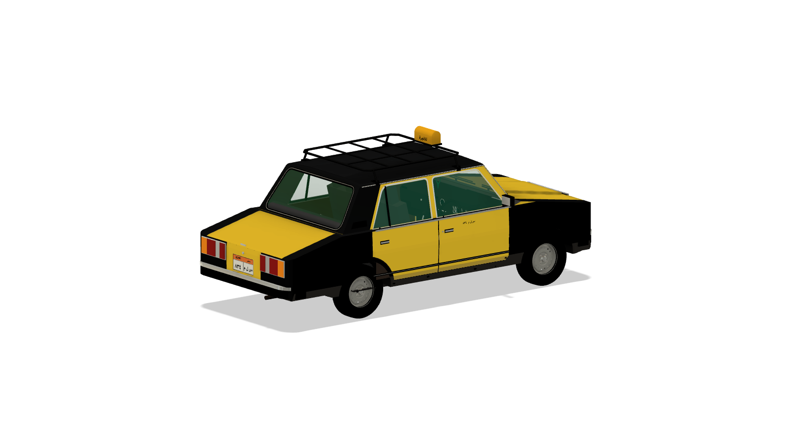
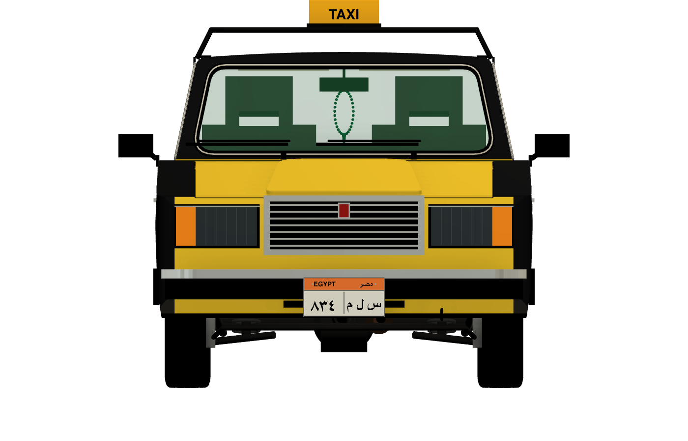
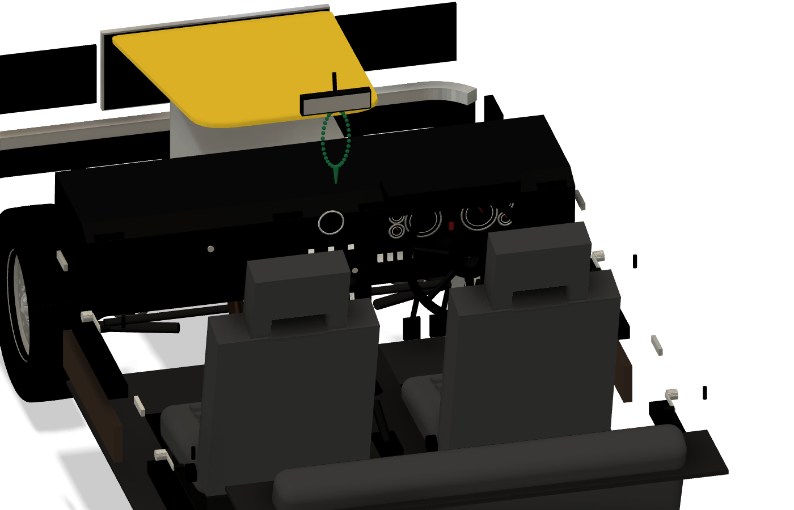

# Alexandria Lada Taxi (VAZ-2107)

A parametric, script-built 1:1 CAD model of the black-and-yellow **VAZ-2107 (Lada 2107 / Riva)** taxi that fills
the streets of Alexandria, Egypt. It is lightly weathered, carries Egyptian taxi plates "٨٣٤ س ل م", a tubular roof
rack and a "للأجرة" roof light, and has a full late-spec interior and schematic running gear.



| | |
|---|---|
|  |  |
|  |  |

## Status
**The published model is Fusion version 5 of "Alexandria Lada Taxi": *Recalibrated to factory drawing; livery,
weathering, interior late-spec, lettering*.** The files in [`models/`](models/) and the renders in
[`docs/renders/`](docs/renders/) show that state.

The scripts in [`fusion/scripts/`](fusion/scripts/) are **ahead of the published model**. They contain a later
refinement pass that has **not yet been rebuilt into the published model** (a partial rebuild exists in Fusion as
"Alexandria Lada Taxi (partial refinement rebuild)" and is not published):

- curved, wrap-around greenhouse loft (windscreen and rear screen wrap round the corners; replaces the flat-screen
  A-pillar compromise, `ws_base_x` 1080 → 1000 on the centreline / 1195 at the corners, `pillar_w` 125 → 48)
- crisp upper swage line and lower crease along the flanks, set-back shoulder
- bonnet step (wing tops 8 mm below the bonnet edge) and raised bonnet centre
- rolled wheel-arch lips
- curved windscreen and rear-screen glass (bands between offset lofts)
- bumper rubber strips and over-riders
- quarter-light divider as a separate rubber channel body
- padded dash top roll and knee panel; striped seat-cloth inserts
- lettering size fix in `place_svg()` (the v5 decals are undersized, see Known gaps)
- the VAZ-2105 variant switch (`variant_2105`, `OVERRIDES_2105`, `make_2105.py`)

**Rebuild order** to bring the published model up to the scripts (run each with the exec loader, see
[`fusion/README.md`](fusion/README.md)):

1. `build_params.py` (writes the new parameters: screen corner stations, `screen_wrap_exp`, swage, step, lip)
2. `build_body.py` → 3. `build_openings.py` → 4. `build_glazing.py` → 5. `build_trim.py` → 6. `build_ends.py`
7. `build_wheels.py` → 8. `build_plates.py` → 9. `build_roof.py` → 10. `build_lettering.py`
11. `build_chassis.py` → 12. `build_seats.py` → 13. `build_interior.py` → 14. `build_weathering.py`
15. `build_appearance.py` (always last after a body rebuild)
16. underlay check against the factory side/front views (`build_canvases.py`), new renders (`snap.py`),
   `safe_save(...)`, re-export `models/`
17. optional: `make_2105.py`, then steps 1-15 again with `TARGET_DOC = 'Alexandria Lada Taxi 2105'`

## The vehicle
The VAZ-2107 is the square-fronted "classic" Zhiguli saloon, built in Togliatti from 1982 to 2012 and assembled in
Egypt until about 2015. Alexandria's taxi fleet was dominated for decades by Egyptian-assembled 2107s (roughly
2002–2015 cars), painted in the city's black-and-yellow scheme. The scheme is a **two-tone split on the panel shut
lines**, not a horizontal band:

- **black:** front wings, rear quarters including the C-pillars, sills, roof
- **yellow:** doors, bonnet, boot lid, tail panel, front valance
- **varies by car:** A/B pillars and door frames (black on most cars, yellow on the reference car; parameter
  `pillars_yellow`)

The car carries the 2008-format Egyptian plate (350 × 170 mm, orange taxi band, "EGYPT" / "مصر", digits left,
letters right; first letter س = Alexandria), the plate number repeated in small Arabic on both front doors, a tubular
roof rack and a small yellow-orange roof light. The model follows the **late-spec** car: tall grille, plastic
bumpers with black caps, 4-spoke steering wheel, grey cloth seats with integrated headrests.
See [`references/notes/`](references/notes/) for the full research.

## What's modelled
| Area | Contents |
|---|---|
| Body | Shell (side ∩ plan ∩ section + greenhouse with tumblehome and roof crown), wheel arches, 3 mm skin; doors, bonnet and boot lid as separate bodies split on 4 mm shut lines |
| Glass + trim | Windscreen, rear screen, door glass; window chrome, screen rubbers, belt mouldings, drip rails, handles, rubbing strips, mirrors, wipers, side markers, C-pillar vents, fuel flap |
| Ends | Chrome grille + badge, rectangular headlamp units with amber indicators, bonnet bulge, tail-lamp clusters, wrap-around bumpers, tow eye, plate lamps |
| Wheels | 175/70 R13 tyre with tread, 5J×13 steel wheel, hubcap, nuts, brake disc; 4 instances |
| Running gear | Double wishbones, coil-overs, anti-roll bar, steering linkage, live axle with 4 links and Panhard rod, engine/gearbox/propshaft, exhaust (schematic but dimensionally placed) |
| Interior | Dashboard (binnacle with gauges, console, clock, radio, vents, glovebox), 4-spoke wheel, pedals, levers, door cards, mats, headliner, visors, rear-view mirror with prayer beads (misbaha), seats and rear bench |
| Taxi kit | Egyptian plates front + rear, door lettering, roof rack, roof light lettered "TAXI" / "للأجرة" |
| Finish | Livery split face-by-face on the shut lines, faded yellow / oxidised black paints, dusty sills, seeded rust blisters |

## Key dimensions
Frame: X from the front bumper face rearwards, Y up from the ground, Z lateral (+Z = the car's right).
**HIGH** = factory data or two independent sources agree; **MED** = read off the factory dimensioned drawing
(±15–25 mm) or a calibrated photo; **LOW** = estimate. Full sheet: [`references/notes/lada-dossier.md`](references/notes/lada-dossier.md).

| Dimension | Value (mm) | Source | Confidence |
|---|---|---|---|
| Overall length | 4145 | AvtoVAZ factory dimensioned drawing; Wikipedia; auto.ru | HIGH |
| Front overhang / wheelbase / rear overhang | 664 / 2424 / 1057 | factory drawing | HIGH |
| Body width (over mirrors) | 1620 (1680) | factory drawing; specs | HIGH |
| Height, unladen | 1446 | factory drawing; auto.ru | HIGH |
| Track front / rear | 1365 / 1321 | factory drawing | HIGH |
| Tyres / rim | 175/70 R13; 5J×13 ET29, 4×98 | specs | HIGH |
| Beltline (side-glass base) | 947 | factory drawing | MED |
| Scuttle / bonnet front edge | 985 / 830 | factory drawing | MED |
| Sill / door bottom | 300 / 370 | factory drawing | MED |
| B-pillar station | 2120 | factory drawing | MED |
| Glass half width at belt / roof half width at drip | 730 / 630 | factory front view | MED |
| Windscreen base station (v5 model, flat screen) | 1080 | compromise between drawing (~1000) and photo (~1200) | LOW |
| Roof crown, tumblehome detail, interior package | – | estimates from photos | LOW |
| Egyptian taxi plate | 350 × 170 | Wikipedia; plate photos | HIGH |

## Variants
- **VAZ-2107, Alexandria taxi** (this model; `pillars_yellow` = 1 yellow pillars as on the reference car, 0 = black
  as on most cars).
- **VAZ-2105** (script support only, not built): `make_2105.py` copies the document; with
  `TARGET_DOC = 'Alexandria Lada Taxi 2105'` the same scripts apply the 2105 overrides (4130 mm, black pillars, flat
  bonnet, low flat grille, separate bumper indicators, tail lamps with vertical stop segments, aluminium bumpers).

## Files
| Path | What |
|---|---|
| [`models/Alexandria Lada Taxi.f3d`](models/) | Fusion archive of the v5 design (the car is a single design; there is no set assembly) |
| [`models/Alexandria Lada Taxi.step`](models/) | STEP export of the same design (533 named solid bodies) |
| [`fusion/scripts/`](fusion/scripts/) | Build scripts, `_lib.py` / `_geom.py` helpers, `canvases.cfg` |
| [`fusion/README.md`](fusion/README.md) | Exec loader and build order |
| [`tools/lettering/`](tools/lettering/) | CoreText text-to-SVG tool, `make_svgs.sh`, the generated SVGs |
| [`docs/BUILD-LOG.md`](docs/BUILD-LOG.md) | Decisions, measurements, Fusion API gotchas |
| [`docs/renders/`](docs/renders/) | Renders of the published model |
| [`references/notes/`](references/notes/) | Dimension sheet, VAZ-2107 specs, livery and plates research |
| [`references/SOURCES.md`](references/SOURCES.md) | Source, author and licence of every reference image (images not included) |

Fusion organisation: project **Eshera-Personal**, folder **Alexandria Lada Taxi**, design **Alexandria Lada Taxi**
(complete, v5 — published here) and **Alexandria Lada Taxi (partial refinement rebuild)** (work in progress, not
published).

## Rebuilding from the scripts
Everything in the model is generated by the scripts. In Fusion, create an empty design named
**Alexandria Lada Taxi**, then run the scripts in the order listed in [`fusion/README.md`](fusion/README.md) with
this loader (it must pass `__file__`; all paths are resolved relative to the repo):

```python
def run(_context: str):
    path = '<repo>/fusion/scripts/<script>.py'
    ns = {'__name__': 'fusion_script', '__file__': path}
    exec(compile(open(path).read(), path, 'exec'), ns)
    ns['run'](_context)
```

Saving goes through `safe_save()` in `_lib.py`, which only saves a document that lives in project
`Eshera-Personal`, folder `Alexandria Lada Taxi`; change `PROJECT_NAME` / `FOLDER_NAME` there for your own setup.

**Lettering.** Arabic text is shaped and outlined with CoreText (`tools/lettering/text2svg.swift`, macOS), so Fusion
never has to lay out Arabic itself. To regenerate the SVGs:

```sh
cd tools/lettering
swiftc -O text2svg.swift -o text2svg
./make_svgs.sh ./text2svg
```

`_R` files are unflipped, `_L` mirrored (for sketch planes whose +x is the viewer's left). `place_svg()` imports
them with `Sketch.importSVG`, scales by the ink box and extrudes the glyphs 0.3–1.8 mm proud.

## Opening the exports
- **`.f3d`**: Fusion → *File → Open → Open from my computer*, or upload into a Fusion project. It keeps the full
  parametric timeline, user parameters and appearances.
  The photo underlay canvases used for calibration are not included (they are third-party photos); recreate them
  from `references/SOURCES.md` with `build_canvases.py` if needed.
- **`.step`**: any CAD tool (FreeCAD, SolidWorks, Onshape, Rhino, ...). Units are millimetres, one solid per part,
  body names preserved; appearances/colours may not survive depending on the importer.

## Printing notes
- The model is a **1:1 master**. Scale on export (e.g. 1:18, 1:24, 1:43); there is no separate print variant yet.
- The 3 mm skin is printable around 1:18 but too thin at smaller scales; thicken (or fill) the shell for small prints.
- Doors, bonnet and boot lid are separate bodies, which makes the two-tone livery easy to print in two colours.
- Lettering and plate decals stand only **0.3 mm** proud at 1:1, which disappears at model scale: print them as
  decals/stickers, or thicken them before scaling.
- Fine parts (wipers, mirror stalks, roof-rack tubes, running gear, interior details) need thickening or omitting
  below about 1:24.

## Known gaps
- The published v5 model predates the refinement pass (see Status): flat windscreen and rear screen, no swage-line
  creases, no bonnet step or arch lips.
- v5 decals were placed before the lettering size fix and come out at roughly 50–93 % of their specified height
  (Arabic worst). A rebuild fixes this.
- Plan-view corner radii, tumblehome and roof crown come from photos only (LOW–MED).
- Interior package (seat H-points, dash depth, wheel position) is estimated from photos; no dimensioned interior
  drawing was found.
- Exhaust exit side, fuel-filler position and rack geometry vary between taxis (LOW).
- Running gear is schematic.
- Not yet cross-checked against the free Sketchfab photogrammetry scan (rsc.jes, Free Standard licence).

## Credits and sources
- Dimensions: AvtoVAZ factory dimensioned 4-view and repair-manual 3-view (via carblueprints.info and
  drawingdatabase.com, reference only), ru/en Wikipedia (ВАЗ-2107 / Lada Riva), auto.ru, autospot.ru.
- Livery, plates and details: dated Alexandria taxi photos on Wikimedia Commons (CC BY / BY-SA; authors credited in
  [`references/sources/livery/MANIFEST.csv`](references/sources/livery/MANIFEST.csv)), Wikipedia *Vehicle
  registration plates of Egypt*, plate diagrams by Nima Farid (CC BY-SA 4.0), and Za Rulem (zr.ru) editorial photos
  for detail reference only.
- Every reference image is listed with source URL, author and licence in
  [`references/SOURCES.md`](references/SOURCES.md); none is redistributed here.

## Licence
- Code (`fusion/`, `tools/`): MIT, see [`LICENSE`](LICENSE).
- Models, documentation and renders (`models/`, `docs/`, `references/notes/`, this README): CC BY 4.0, see
  [`LICENSE-models.md`](LICENSE-models.md).

© 2026 Ibrahim Eshera
